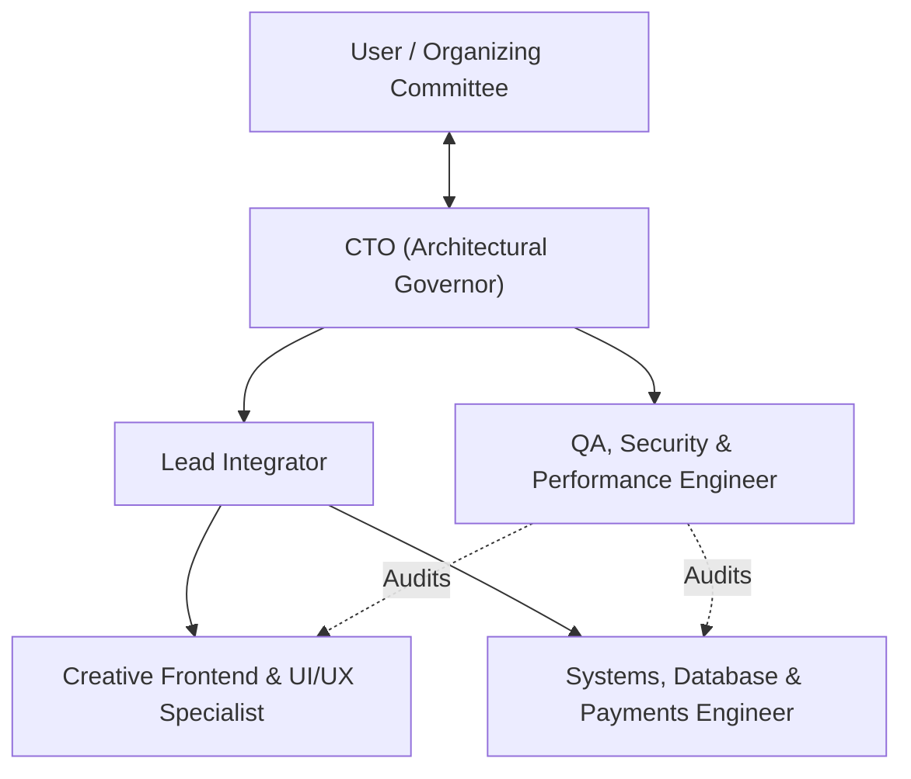

# Unconditional Love 3 — Multi-Agent Engineering Team

This directory defines the specialized agent team structure, operational roles, and governance protocols for **Unconditional Love 3 (UL3) — Bring One Another**.

---

## 1. Team Hierarchy & Collaboration Model

The team follows a disciplined, phase-gated execution model overseen by the **Chief Technology Officer (CTO)**. No agent is permitted to work ahead of the active phase or violate architectural security boundaries.

---

## 2. Agent Roster

| Role | Specification File | Primary Scope | Responsibilities |
|---|---|---|---|
| **Chief Technology Officer (CTO)** | [`cto.md`](./cto.md) | All Tracks & Gates | Architectural governance, security policies, phase gate approvals, and committee decision escalation. |
| **Creative Frontend & UI/UX Specialist** | [`creative-frontend.md`](./creative-frontend.md) | Track A (F0–F7) | Painterly visual theme, design tokens, responsive components (360px+), and truthful presentation. |
| **Systems, Database & Payments Engineer** | [`backend-payments.md`](./backend-payments.md) | Track B (B1, B2, B4, B5, B6) | Supabase PostgreSQL schema, RLS, atomic seat allocation, payment gateway callbacks, QR tokens, and email outbox. |
| **Operations & On-Site Experience Engineer** | [`ops-on-site.md`](./ops-on-site.md) | Track B (B3, B7) & Track C (O1–O2) | Protected admin dashboards, role-based access, mobile QR scanner for venue admission, and data retention/purge. |
| **QA, Security & Performance Auditor** | [`qa-security.md`](./qa-security.md) | Cross-Cutting Verification | Concurrency testing, security penetration tests, WCAG AA audits, and automated build verification. |

---

## 3. Core Operating Protocols

1. **Strict Phase Gating:** Agents execute **one phase at a time**. After each phase, code must pass:
   - `npx tsc --noEmit`
   - `npx eslint .`
   - `npm run build`
2. **Truth in Data:** Never invent facts, agendas, speakers, contact channels, or refund promises. Content must be driven by `src/data/event.ts`.
3. **Zero-Trust Security:** Client-side amounts or redirects are never trusted. All state changes, seat reservations, and payment confirmations happen inside trusted server transactions or DB functions.
4. **CTO Approval Gate:** No phase is finalized without explicit CTO sign-off against the phase acceptance checklist.

